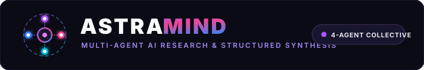
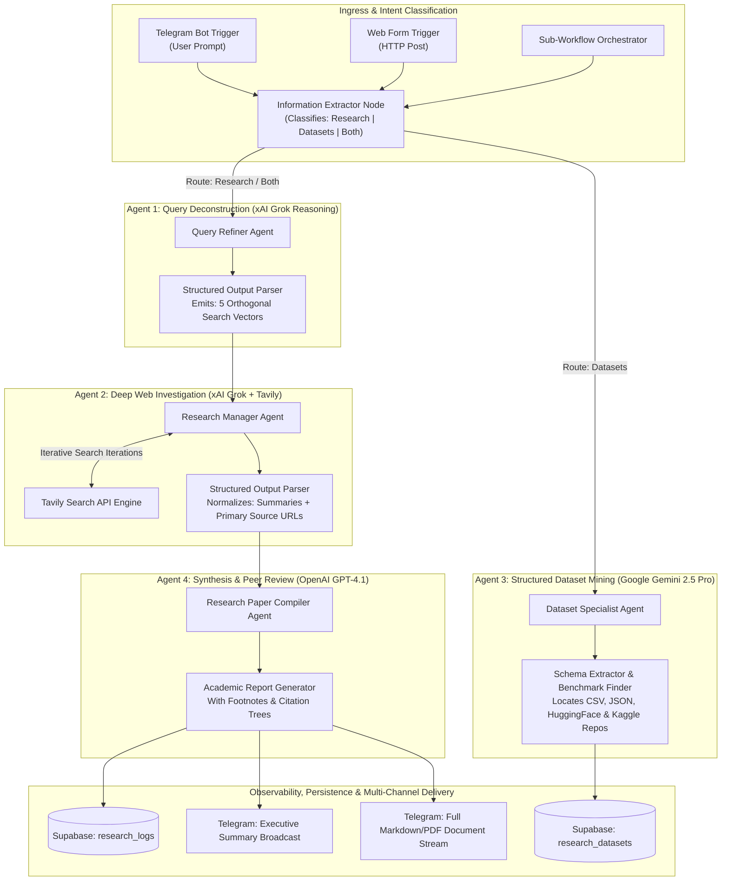
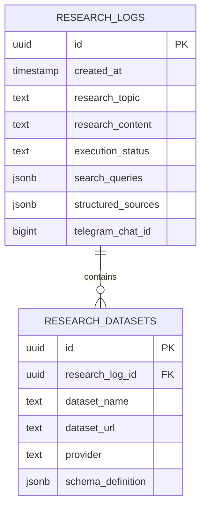

<p align="center">
  
</p>

<p align="center">
  <strong>Heterogeneous Multi-Agent AI Research &amp; Structured Synthesis Collective with Real-Time Web Grounding, Relational Schema Extraction &amp; Multi-Channel Delivery</strong>
</p>

<p align="center">
  <a href="https://www.linkedin.com/in/akashjadon"></a>
  <a href="https://github.com/akashjadon04"></a>
  
  
  
</p>

---

## ⚡ Executive Summary & The Multi-Agent Thesis

Monolithic single-prompt AI workflows suffer from severe foundational liabilities when tasked with deep domain research:

1. **Hallucination & Unverified Reasoning**: Models generate plausible-sounding citations and statistical figures when cut off from iterative live web retrieval.
2. **Schema Drift & Structured Parsing Failure**: Open-ended conversational models frequently fail strict JSON schema validation when simultaneously attempting dense prose generation.
3. **Monolithic Model Blindspots**: No single frontier model excels equally at open reasoning, low-latency live web tooling, high-context relational schema parsing, and polished academic report compilation.

**Astra Mind** solves this by establishing a **4-Agent Heterogeneous Cognitive Collective**. Rather than forcing a single model to act as generalist, Astra Mind decomposes the research lifecycle into an orchestrated multi-agent assembly pipeline where frontier models from **xAI**, **Google DeepMind**, and **OpenAI** execute solely within their domains of peak empirical capability.

---

## 🏛️ Cognitive Topology & Execution Flowchart



---

## 🤖 The 4-Agent Committee Specialization Matrix

| Agent | Core Engine | Primary Responsibility | Output Artifact |
| :--- | :--- | :--- | :--- |
| **Agent 1: Query Refiner** | **xAI Grok Reasoning** | Deconstructs ambiguous prompts into distinct, non-overlapping search hypotheses and queries. | Typed JSON with 5 distinct web query vectors |
| **Agent 2: Research Manager** | **xAI Grok + Tavily** | Autonomous tool-calling agent executing iterative live web searches across primary sources. | Structured synthesis map with verified citation links |
| **Agent 3: Dataset Specialist** | **Google Gemini 2.5 Pro** | Long-context quantitative miner finding benchmark tables, open CSVs, and academic data repositories. | Structured schema tables and dataset links |
| **Agent 4: Research Compiler** | **OpenAI GPT-4.1** | Synthesizes all gathered intelligence into an exhaustive, publication-ready research paper. | Academic Markdown report with citation footnotes |

---

## 🔒 Structured Output Contracts

Astra Mind enforces strict JSON Schema boundary contracts between agent hops, preventing hallucinations from breaking downstream execution:

### 1. Query Refinement Contract
```json
{
  "topic": "Quantum Annealing for Supply Chain Optimization",
  "searchQueries": [
    "Quantum annealing commercial benchmarks logistics 2025 2026",
    "D-Wave Leap vs classical integer programming routing",
    "Real-world enterprise deployments quantum annealing supply chain",
    "Hardware limitations qubit coherence logistics optimization",
    "Leading academic papers quantum heuristics fleet management"
  ]
}
```

### 2. Research Evidence Contract
```json
{
  "topic": "Quantum Annealing for Supply Chain Optimization",
  "results": [
    {
      "query": "D-Wave Leap vs classical integer programming routing",
      "summary": "Comparative benchmarks show hybrid classical-quantum heuristics achieve 14% lower latency on 10,000+ stop vehicle routing problems...",
      "sources": [
        {
          "title": "Empirical Evaluation of Quantum Optimization in Logistics",
          "url": "https://arxiv.org/abs/example"
        }
      ]
    }
  ]
}
```

---

## 🗄️ Supabase Persistence & Observability

All agent turns, intermediate search findings, and compiled papers are automatically indexed in Supabase PostgreSQL:



---

## 🚀 Quick Start Guide

### 1. Prerequisites
- Docker & Docker Compose
- API Keys: xAI Grok, Google Gemini, OpenAI, Tavily, Telegram Bot Token, Supabase Project

### 2. Deploy the Stack

```bash
# Clone the repository
git clone https://github.com/akashjadon04/astra-mind.git
cd astra-mind

# Configure environment variables
cp .env.example .env

# Start n8n engine
make up
```

### 3. Initialize Supabase Database
Execute `schema/supabase_schema.sql` in your Supabase SQL Editor to initialize the `research_logs` and `research_datasets` tables with Row Level Security.

### 4. Import Workflow into n8n
1. Open [http://localhost:5678](http://localhost:5678).
2. Go to **Workflows** -> **Import from File**.
3. Select `workflows/astra-mind-collective.json`.
4. Connect credentials for:
   - `xAI Grok API`
   - `Google Gemini API`
   - `OpenAI API`
   - `Tavily API`
   - `Supabase API`
   - `Telegram Bot API`
5. Activate the workflow.

---

## 📂 Repository Layout

```
astra-mind/
├── assets/
│   └── astra-mind-banner.svg         # Vector branding and architecture header
├── docker-compose.yml                # Production n8n container specification
├── .env.example                      # Environment credentials template
├── Makefile                          # Container lifecycle automation
├── prompts/                          # Extracted prompt engineering directives
│   ├── 01-query-refiner.md           # Agent 1 system prompt
│   ├── 02-research-manager.md         # Agent 2 system prompt
│   ├── 03-dataset-agent.md           # Agent 3 system prompt
│   └── 04-research-compiler.md       # Agent 4 system prompt
├── schema/
│   └── supabase_schema.sql           # PostgreSQL table definitions & RLS
└── workflows/
    └── astra-mind-collective.json    # Full 42-node production n8n workflow
```

---

## 👨‍💻 Architected & Developed By

<p align="left">
  <strong>Akash Jadon</strong><br/>
  Principal Automation &amp; AI Systems Architect<br/>
  💼 LinkedIn: <a href="https://www.linkedin.com/in/akashjadon">https://www.linkedin.com/in/akashjadon</a><br/>
  🐙 GitHub: <a href="https://github.com/akashjadon04">https://github.com/akashjadon04</a>
</p>

---

## 📄 License

Distributed under the MIT License. See [LICENSE](LICENSE) for full details.
